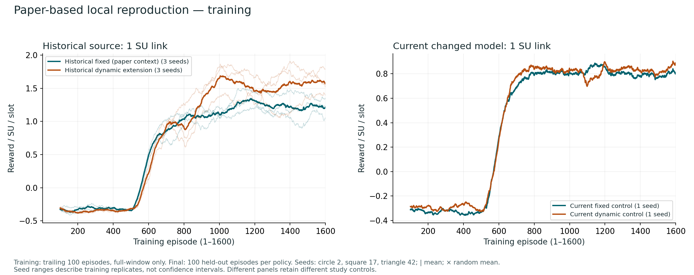
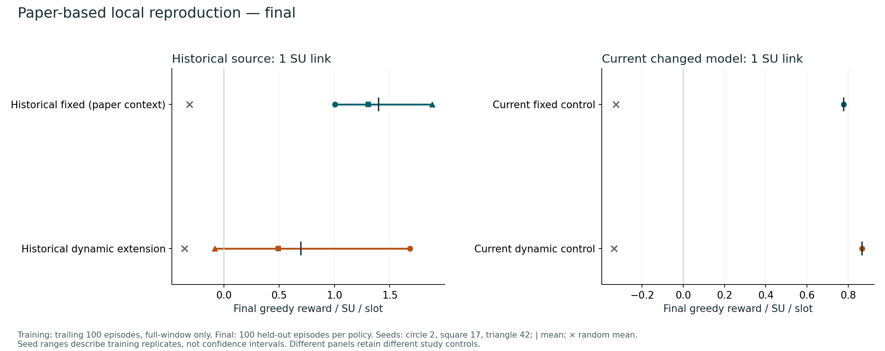
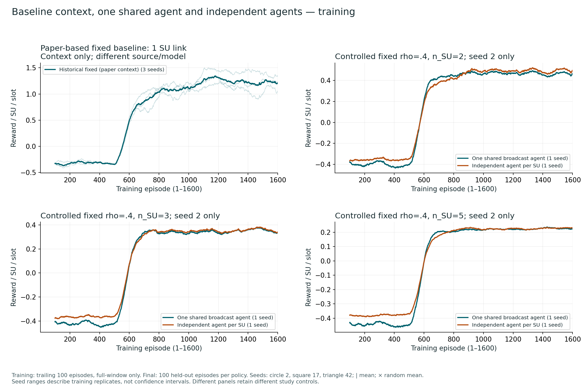
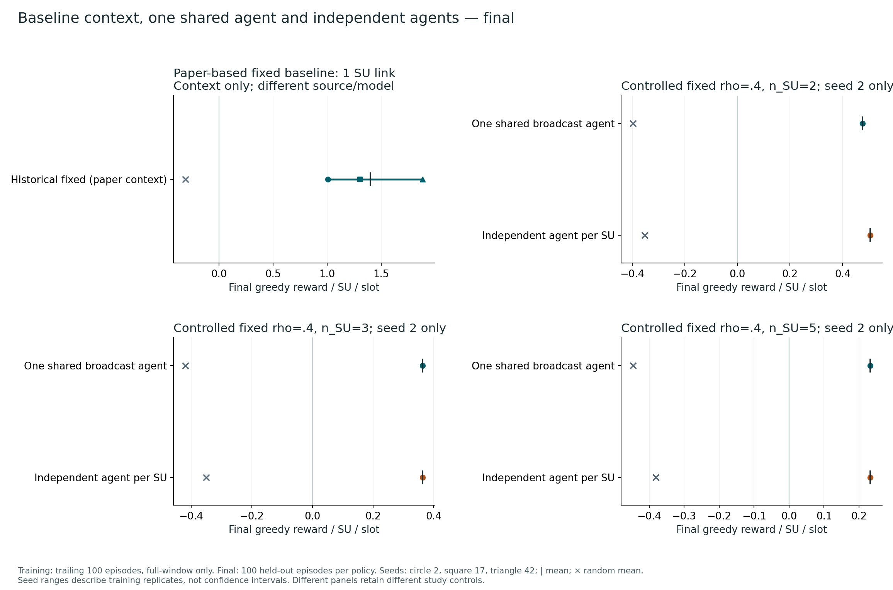
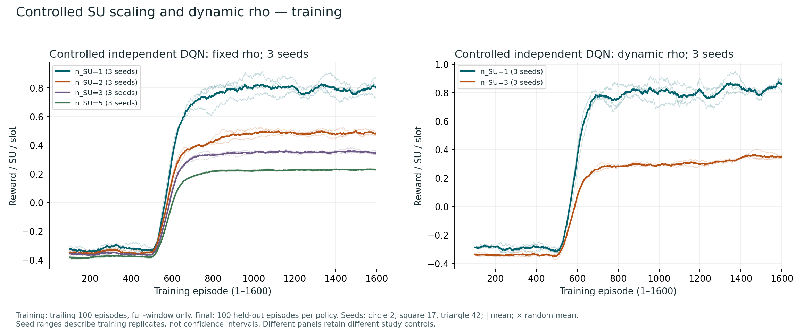
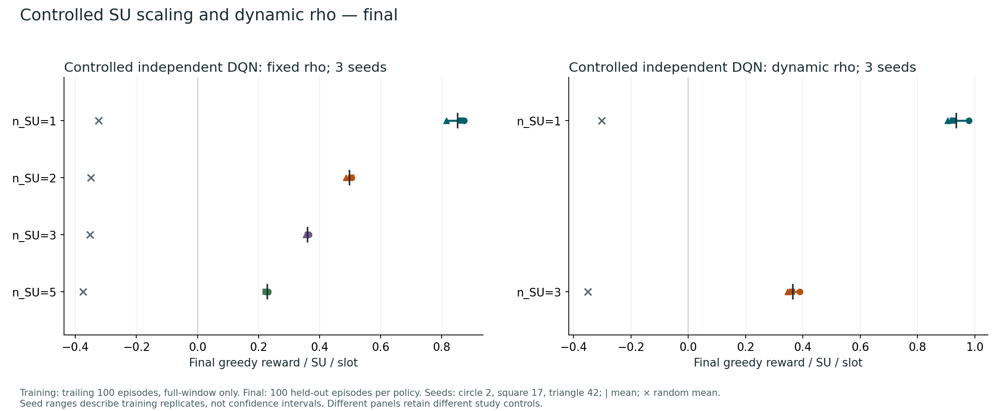
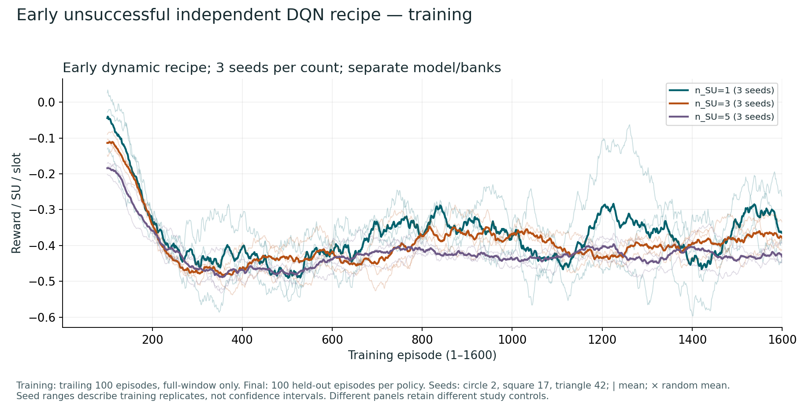
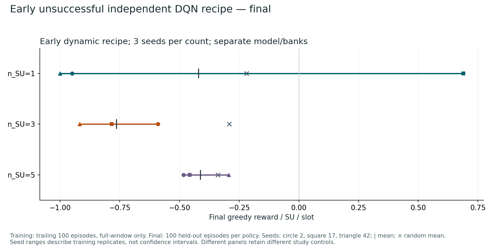
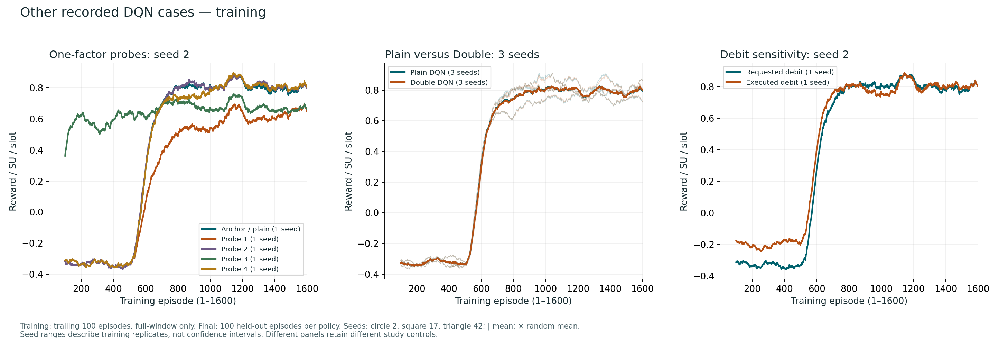
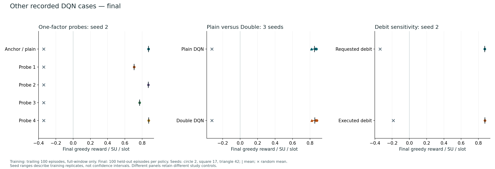

# Independent learning: progress and limits

## Section 1: Why

Controlled independent DQN learned across the tested transmitter counts. Corrected one-SU DRQN did not establish a consistent improvement.

The research asks whether secondary users (SUs), simulated secondary radio transmitters, can learn their own energy-harvesting policies. It also asks whether memory helps with delayed observations. A shared controller broadcasts one action and learns summed reward. Independent agents choose together and learn only their own reward.

Historical source recovery showed qualitative learning, but the recovered candidate is not proven to have generated the original logs. Exact paper or saved-curve reproduction is unestablished. Different source models, actions, debit rules and banks prevent one causal leaderboard. Reward is not validated physical throughput.

## Section 2: Summary

- Baseline recovery beat matched random controls, with variable dynamic generalization.
- The early independent DQN recipe failed at N = 1, 3, 5 despite working agent isolation.
- Controlled DQN passed recorded study gates at fixed N = 1, 2, 3, 5 and dynamic N = 1, 3.
- Corrected fixed N = 1 DRQN gave mean paired gain +0.010206447; one of three seeds improved. Its frozen criterion failed.
- Multi-SU DRQN is implemented, but N = 2 was not admitted by budget and N = 3 was skipped.

Episodes contain 20 slots. The new DQN figures use reward per SU per slot; the legacy inventory keeps raw episode reward. Reward includes penalties; recorded score sums compatibility-score contributions from executed transmissions. Fixed rho is 0.4; the dynamic set {1/8,…,7/8} excludes 0.4. Three training seeds remain three training replicates, even with 100 evaluation episodes per policy.

The [standalone report](RESEARCH_REPORT.html) embeds the checked comparison charts, neural diagrams, radio diagram and equations.

## Section 3: Changes

This PR includes the independent-agent and stability implementation, plus corrected DRQN and public documentation. Each SU owns policy, target, optimizer, replay, random generators and, for DRQN, memory.

The early evaluated recipe used 64 × 64 layers, Adam 0.001, Huber loss, batch 8 and executed-only debit. Controlled DQN uses 128 × 128 layers, SGD 0.003, MSE, batch 64, gamma 0.99 and requested debit. Targets update with tau 0.001 every fifth zero-based episode, including zero. Double DQN is supported, but the selected recipe uses plain target maximization and no clipping. The studies changed several factors; they do not identify a single cause.

Corrected [GRU64 replay](src/multi_agent/recurrent.py) stores 20-transition episodes with 21 observations. Policy and target process four full episodes from zero. Successor histories retain observation zero; 64 of 80 positions enter MSE. Acting memory advances during random actions, refreshes after updates, and resets between episodes. The legacy recurrent path did not satisfy this chronological contract.

The local TD target is `y = r + 0.99 * (1-d) * max Q_target(next_history)`. Terminal targets contain reward only. Corrected one-SU DQN/DRQN use 22,048/16,672 parameters, so the comparison does not isolate memory alone.

The [environment](src/multi_agent/environment.py) applies previous harvest and debit at the next battery boundary. Requested debit can charge rejected transmit requests. Both action branches harvest. Numeric dBm score arithmetic, density-grid channels and per-SU primary checks do not validate physical throughput or aggregate primary protection. Historical equations differ from this later model.

See [MULTI_AGENT.md](MULTI_AGENT.md) for independent DQN and [DRQN.md](DRQN.md) for recurrent checks and external study-input requirements.

## Section 4: Result

Controlled DQN learned in the retained studies. The shared-versus-independent comparison is limited to one matched training seed. Paper-based reproduction appears as separate context.

Scroll wide charts horizontally on small screens.

Every new training figure retains all 1,600 source episodes in [figure data](assets/dqn-comparisons/figure-data.json). [Final metrics](assets/dqn-comparisons/final-metrics.csv) include all 46 complete runs and the training tail separately.

Training uses a trailing 100-episode arithmetic mean with `min_periods=100`; the first displayed point is episode 100. There is no padding or interpolation. Stability episode IDs 0–1599 become 1–1600; other records already use 1–1600. Faint curves show training seeds; bold curves show their equal-weight mean.

Reward per SU per slot is the sum of the joint reward vector divided by `20 * n_SU`. Baseline scalar reward is divided by 20 for context only. Reward includes penalties and is not validated physical throughput or energy efficiency. Final points average 100 held-out greedy episodes per training seed. A vertical tick marks the seed mean, a horizontal line its seed range, and a cross the corresponding random mean. These are not confidence intervals. Three training seeds remain three replicates; 100 audit episodes are not 100 training seeds.

### DQN: Paper-based local reproduction

The requested baseline is the local paper-based DQN reproduction, with random as its control. The reference paper uses one SU link and action `(kappa, power)`, with rho fixed within each experiment. Historical fixed rho = 0.4 is the local reproduction candidate. Historical dynamic rho is an extension. Current-source controls use a changed model; they are separate cohorts.

Tashman, Cherkaoui and Hamouda, *Performance Optimization of Energy-Harvesting Underlay Cognitive Radio Networks Using Reinforcement Learning*, IWCMC 2023, pp. 1160–1165, [DOI](https://doi.org/10.1109/IWCMC58020.2023.10182973), provide published curves, not the retained local raw data. Their smoothing, seed counts and normalization are insufficiently specified for exact numerical comparison. No exact numerical reproduction is established.

| Case | Training seeds | Last 100 training | Final greedy | Random |
| --- | --- | ---: | ---: | ---: |
| Historical fixed, paper-based context | 2, 17, 42 | 1.212943 | 1.398023 | -0.311023 |
| Historical dynamic extension | 2, 17, 42 | 1.567851 | 0.697037 | -0.355493 |
| Current-source fixed control | 2 | 0.800998 | 0.778360 | -0.326263 |
| Current-source dynamic control | 2 | 0.880831 | 0.866480 | -0.336157 |

The historical candidate is not proven to have produced the original saved logs. Historical fading and power conversion differ from the paper. Current controls change fading, activation, battery, time, feasibility and rate accounting. Action sets, observations, target updates and clipping also differ. Current fixed uses the completed replacement run after instrumentation problems; current evaluations were recovered after an evaluator defaulted to ten SUs. These qualifications remain part of the evidence.

Historical dynamic seed 42 has positive late-training reward but final reward −0.082235 per slot. That audit remained above its random control but below zero. Training improvement does not guarantee held-out generalization.

### DQN: One shared agent versus independent agents

Both controllers act in one joint environment. One shared agent sees flattened global observations, broadcasts one action to every SU and learns summed reward. Independent agents choose their own actions from their own observations and learn their own rewards. The comparison changes information, objective, action structure and capacity together.

The fixed-rho panels compare seed 2 at n_SU = 2, 3 and 5. Configurations, training traces, action maps and audit traces match within each count. Paper-based one-link reproduction stays in a separate context panel because its source and model differ.

| n_SU | Independent seed 2 | Shared seed 2 | Shared − independent |
| --- | ---: | ---: | ---: |
| 2 | 0.505394159 | 0.476067172 | -0.029326986 |
| 3 | 0.364288854 | 0.363765201 | -0.000523653 |
| 5 | 0.232259661 | 0.231588162 | -0.000671499 |

Shared seed 2 was lower by about 0.029327, 0.000524 and 0.000671 at the three counts. One seed cannot establish superiority or convergence. Shared and independent random action structures also differ. Shared seeds 17 and 42 were not run.

### DQN: Controlled SU scaling and dynamic rho

The controlled independent study recorded fixed n_SU = 1, 2, 3, 5 and dynamic n_SU = 1, 3, with seeds 2, 17, 42. Final audit seed 910002 is separate from selection-monitor seed 910001. Baseline and early held-out evaluation use seed 900002; matching a seed number across different study models does not make their banks comparable.

| Case | Training seeds | Last 100 training | Final greedy | Random |
| --- | --- | ---: | ---: | ---: |
| Fixed independent n_SU=1 | 2, 17, 42 | 0.795138 | 0.851535 | -0.323089 |
| Fixed independent n_SU=2 | 2, 17, 42 | 0.484593 | 0.498276 | -0.349034 |
| Fixed independent n_SU=3 | 2, 17, 42 | 0.344823 | 0.360747 | -0.351447 |
| Fixed independent n_SU=5 | 2, 17, 42 | 0.228612 | 0.228109 | -0.374923 |
| Dynamic independent n_SU=1 | 2, 17, 42 | 0.858314 | 0.936180 | -0.302057 |
| Dynamic independent n_SU=3 | 2, 17, 42 | 0.349362 | 0.365883 | -0.350478 |

All six groups passed the recorded learning, health, score and execution gates against initial and random controls. Per-SU reward declines with SU count. Fixed network reward per slot rises from 0.851535 at n_SU = 1 to 1.140543 at n_SU = 5. Recorded gates do not prove optimality or convergence.

Dynamic shared, dynamic n_SU = 2 and dynamic n_SU = 5 were not run in this controlled study. Fixed rho is 0.4. The dynamic grid {0.125, 0.250, 0.375, 0.500, 0.625, 0.750, 0.875} excludes 0.4. The contrast cannot isolate the value of adaptation alone.

### DQN: Early unsuccessful independent recipe

The early dynamic recipe failed held-out learning at n_SU = 1, 3 and 5. The complete replacement n_SU = 5, seed 42 run supplies its curve; the interrupted attempt is excluded.

| Case | Training seeds | Last 100 training | Final greedy | Random |
| --- | --- | ---: | ---: | ---: |
| Early dynamic independent n_SU=1 | 2, 17, 42 | -0.365138 | -0.420125 | -0.218698 |
| Early dynamic independent n_SU=3 | 2, 17, 42 | -0.378871 | -0.763595 | -0.291785 |
| Early dynamic independent n_SU=5 | 2, 17, 42 | -0.430762 | -0.411412 | -0.338165 |

In the final 100-episode greedy audit, 20 of 27 SU policies recorded no successful transmissions. Excessive action-value estimates accompanied failure; the records do not establish one cause. This recipe used different layers, optimizer, loss, debit accounting, model and banks. It cannot support a causal before/after comparison with controlled DQN.

### DQN: Probes, Double DQN and debit sensitivity

Four seed-2 probes changed Adam, batch size 8, step exploration (epsilon end 0.05, decay 500), or hidden width 64. All four failed the recorded promotion decision. Double DQN learned across three seeds but was not promoted; plain DQN remained selected. Selection used monitor evidence, not the held-out audit points shown here.

| Case | Training seeds | Last 100 training | Final greedy | Random |
| --- | --- | ---: | ---: | ---: |
| Fixed independent n_SU=1 | 2, 17, 42 | 0.795138 | 0.851535 | -0.323089 |
| Probe 1 | 2 | 0.651970 | 0.707278 | -0.340061 |
| Probe 2 | 2 | 0.801200 | 0.872420 | -0.340061 |
| Probe 3 | 2 | 0.666972 | 0.770581 | -0.340061 |
| Probe 4 | 2 | 0.807219 | 0.874988 | -0.340061 |
| Double DQN n_SU=1 | 2, 17, 42 | 0.798267 | 0.854653 | -0.323089 |
| Executed debit sensitivity | 2 | 0.801822 | 0.876470 | -0.187508 |

The executed-debit sensitivity uses seed 2 and was excluded from selection. Its configuration, training and monitor traces, action map and initial weights match the anchor; environment accounting differs in `debit_mode`. That single pair cannot establish a general debit effect. The source parity sidecar validates implementation agreement; it is not a 47th independent training run.

### DQN: Legacy records and missing paper sweeps

The 19 legacy non-GRU log files each contain 1,600 indexed training records. Their producer and training seeds are unverified. Filename SU labels are not validated. Their last-100 values below are raw model reward per episode, without SU normalization. No verified held-out audit exists, so these records do not enter the comparison figures.

| Legacy file | Actions | Observations | Last 100 raw episode reward |
| --- | ---: | ---: | ---: |
| base_result_1.log |34|11|26.473710105|
| base_result_5.log |34|75|7.528651660|
| base_result_10.log |34|200|-.588197031|
| base_result_10_1.log |66|200|4.538429397|
| base_result_dynamic_rho_1.log |238|11|42.831108128|
| base_result_dynamic_rho_5.log |238|75|3.933963091|
| base_result_dynamic_rho_10.log |238|200|-.761028678|
| proposed_result_hard_update_1.log |66|12|11.968496562|
| res_1.log |34|10|46.497116779|
| res_5.log |34|70|12.352800493|
| res_10.log |34|190|12.425918258|
| res_dynamic_rho_1.log |238|10|68.197744942|
| res_dynamic_rho_5.log |238|70|18.709087125|
| res_dynamic_rho_10.log |238|190|17.115115119|
| res_dynamic_rho_15.log |238|360|15.724434250|
| res_dynamic_rho_20.log |238|580|16.067239246|
| res_hard_update_1.log |238|10|56.119880579|
| res_hard_update_5.log |238|70|15.415478074|
| res_hard_update_10.log |238|190|16.935746193|

Hard-update filenames do not establish fixed rho: retained action counts and rho values show dynamic cases. The inventory does not represent all duplicate or GRU logs.

No matched controlled local paper sweep was identified for A, lambda, battery capacity or fixed rho. Older records remain unverified. Paper Figure 2 uses A = 6/10, rho = 0.5, lambda = 0.1, Cmax = 0.5; Figure 4 uses lambda = 0.01/0.2/0.4, A = 10, rho = 0.4, Cmax = 0.5; Figure 5 varies Cmax = 0.1–0.7 at rho = 0.2/0.4/0.6. Paper N = 20 denotes slots; this report uses n_SU for link count. No matched multi-SU paper reproduction is available.

### DRQN: Later-stage corrected recurrent results

Corrected fixed N = 1, final episode-1600 checkpoints, reward per SU per slot:

| Training seed | DQN | DRQN | DRQN − DQN |
| --- | --- | --- | --- |
| 2 | 0.860216 | 0.854832 | −0.005384 |
| 17 | 0.753696 | 0.818894 | +0.065197 |
| 42 | 0.835579 | 0.806386 | −0.029194 |
| Mean | 0.816497 | 0.826704 | +0.010206 |

The full-precision mean paired gain is +0.010206447, sample SD 0.049089. The criterion required mean gain at least 0.05 and at least two positive seeds; neither passed. Rounded values can differ from subtraction of displayed means. All six final policies beat initial and random controls. Mean score was 0.835831 DQN versus 0.834370 DRQN, so reward gain was not score gain.

Paired banks, action maps and checkpoint timing were matched; capacity, replay, warmup, history, RNG consumption and compute were not. Use the newly trained paired DQN here, rather than the earlier stability mean. DRQN charged 644.356997 versus 209.533602 training wall seconds across three cells, approximately 3.08 times as much, excluding overhead. This is not inference speed or energy efficiency.

The study records 37 scientific tests and independent scientific model review. A fresh public-checkout rerun also passed all 37 tests with exit 0. Document checks do not establish independent full-report browser acceptance or human acceptance. No new experiment ran for this report.

Full frozen-study reproduction needs the exact external protocol and prior trace bundle; these are not included. The next research step is a defined memory hypothesis, paired baselines, more seeds and an agreed budget. Multi-SU recurrent performance remains untested.
